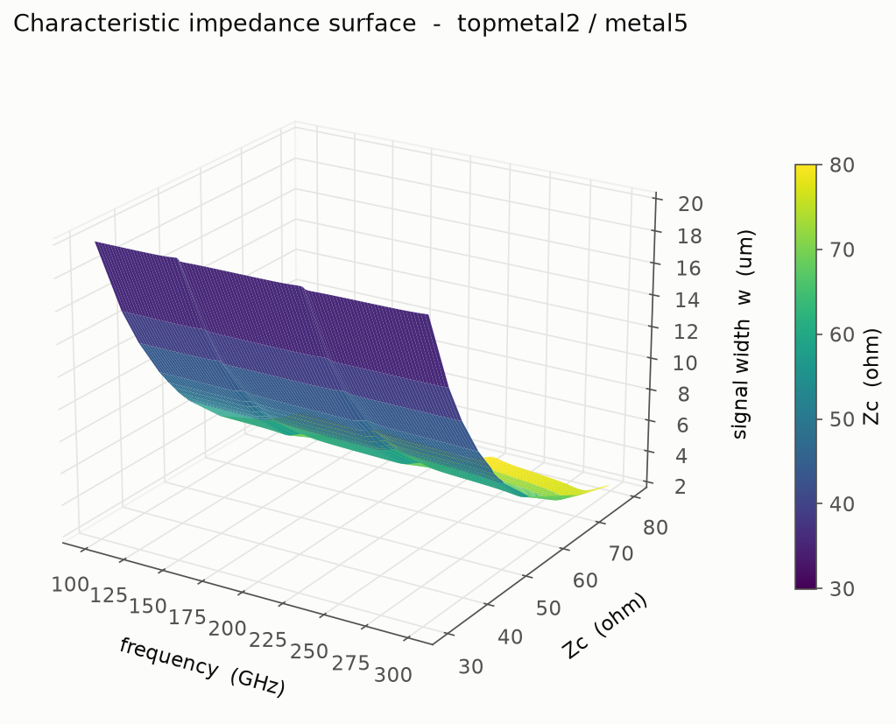
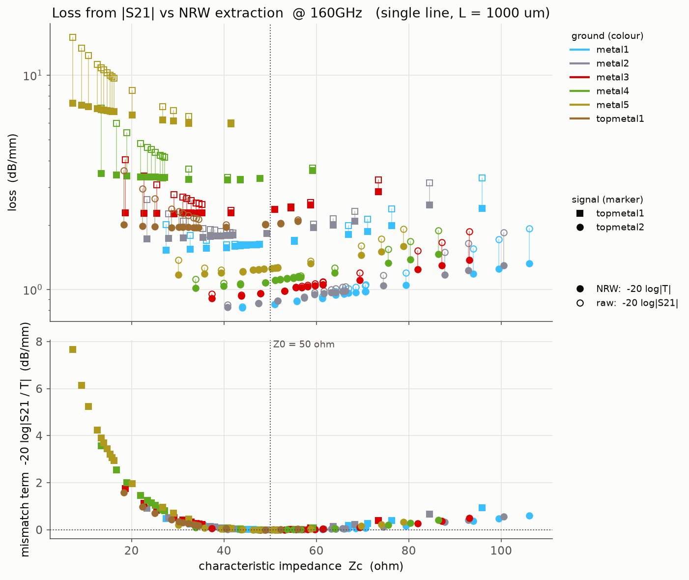
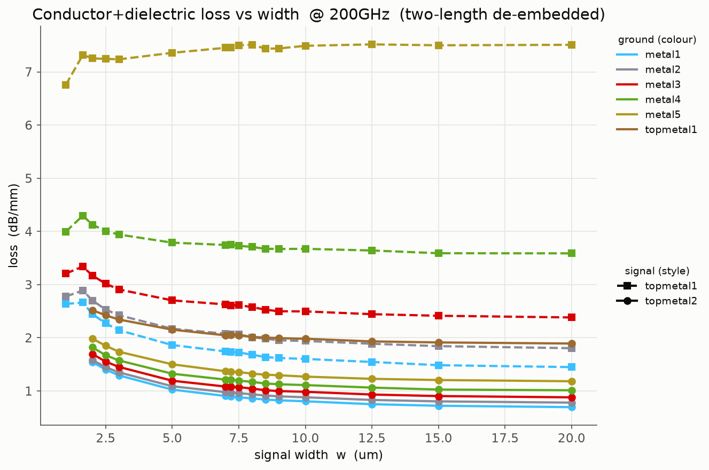

# RF structure evaluation (IHP SG13G2)

EM characterization of passive RF structures in the IHP SG13G2 open PDK, using
[gdsfactory]/[IHP PDK] for layout, [Palace] for the FEM field solve, and
[scikit-rf] for S-parameter post-processing.

The whole flow is driven by the [`Makefile`](Makefile) — run `make help` for the
target list.

```
generate  ->  sim  ->  plot
 (Python)     (Palace)  (Python)
```

1. **generate** — build GDS layouts of test structures into `gds/<sweep>/`
2. **sim** — mesh each GDS and run Palace, then convert the raw solver output to
   Touchstone (`.sNp`) with `combine_snp.py`
3. **plot** — extract the figures of merit from the `.sNp` files into `images/`

---

## Quick start

Do one sweep end to end (the z0 sweep is the cheapest — one design frequency per line):

```bash
make generate-tline-z0
make sim-tline-z0        # runs Palace on every generated GDS (slow)
make plot-tline-z0       # writes images/tline_z0_<freq>GHz.png + .csv
```

The same three-step pattern works for every sweep (`-tline-loss`, `-blc`, …).

> **Cost warning.** Each `sim-*` target launches one Palace run per GDS file. The
> full tline sweeps are hundreds–thousands of runs (hours of compute). Generate and
> simulate one sweep at a time; don't run `make all` unattended.

### Re-running everything on a server

[`server_run.sh`](server_run.sh) (also `make server`) is the unattended version: it
checks the environment, then generates, simulates and plots every sweep, logging to
`logs/server_<date>.log`. Inside an IIC-OSIC-TOOLS container with gds2palace ≥ 0.9.0
(the nightly image `ghcr.io/iic-jku/iic-osic-tools:nightly`, or 2026.11 and later):

```bash
cd <repo>/evaluation
git pull
nohup ./server_run.sh > /dev/null 2>&1 &   # or run it in tmux/screen
tail -f logs/server_*.log
```

The image does not ship the `ihp` package: the script puts this checkout on
`PYTHONPATH` and installs its missing dependency `doroutes` into the user site.
Each finished model gets a `.sim_done` marker with the settings it was simulated
with, so after an interruption just start the script again — finished models are
skipped, unfinished ones start over. A failed model doesn't stop the sweep; the
failures are listed at the end and the raw data is kept for debugging. Override the
defaults with environment variables, e.g. `SWEEPS="tline-loss" PALACE_NP=32 ./server_run.sh`.

### Conductor model

`CONDUCTOR_MODEL` (default `solve_inside_skin`) selects gds2palace's conductor model:
`surface` (surface impedance on all faces, fastest), `solve_inside` (metals meshed as
volumes) or `solve_inside_skin` (volumes plus thin layers along all faces for the
skin effect). The surface model gets thick top-metal lines 8–22 % too low in
resistance at 50–150 GHz and up to doubles the loss of thin Metal1–Metal5 ground
planes, so the loss figures need a volume model; Zc, match and balance agree within
about 1 % between the models (see gds2palace's
[conductor model study](https://github.com/VolkerMuehlhaus/gds2palace_ihp_sg13g2/tree/main/more_examples/conductor_models)).
`REFINED_CELLSIZE` (default 2 µm) is the mesh size in the conductors. Both are
`make` variables too: `make sim-tline-loss CONDUCTOR_MODEL=surface`.

---

## The sweeps

| Sweep | Structure | What it measures | Ports | Design frequencies |
|-------|-----------|------------------|-------|--------------------|
| `tline-z0` | straight line, width swept, `L = 1000 µm` | characteristic impedance `Zc(w)`, single-line loss | 2 | 200 GHz |
| `tline-loss` | straight line, two lengths per point (`500`/`1000 µm`) | loss per mm `α(w)` | 2 | 200 GHz |
| `tline-sparams` | fixed-50 Ω line, `L = 1000 µm` | raw S-parameters (verification) | 2 | 200 GHz |
| `blc` | branch-line coupler, one per design freq | coupling / isolation / phase balance | 4 | 60–300 GHz, step 20 |
| `wpd` | Wilkinson power divider (U-shape), one per design freq | split / match / phase balance | 3 | 60–300 GHz, step 20 |
| `bpf` | hairpin coupled-line BPF of the NorCAS paper (Butterworth, order 3, 5 % BW, TM2/M5) | S11 / S21, insertion loss, −3 dB bandwidth | 2 | 60, 160, 300 GHz (`BPF_FREQS`) |

Each Palace run sweeps **0.5×–1.5× its design frequency**, so a 200 GHz sim covers
100–300 GHz and any value in that band can be read back without re-simulating.

Signal widths for both tline sweeps are
`1.64, 2, 2.5, 3, 5, 7, 7.2, 7.5, 8, 8.5, 9, 10, 12.5, 15, 20 µm` (1.64 µm is the
TopMetal1 minimum). All sweeps are restricted to **RF-viable metal stacks** — signal
on `TopMetal1` or `TopMetal2` (the thick, low-resistance top metals), any lower metal
as ground (`RF_METAL_STACKS` in [`tline_common.py`](tline_common.py)). The thin
`Metal1`–`Metal5` layers are logic/routing layers and aren't sensible RF signal lines,
so they're excluded. Sweep parameters live at the top of each `generate_*.py` and are
the intended place to edit.

---

## Results

Figures below are the PNGs written into `images/` by `make plot`. They point at the
files by path, so re-running a `plot-*` target that overwrites the same filename
refreshes the image here automatically (commit the new PNG). If you change which
frequencies or stacks are swept the filenames change, so the embeds below have to be
updated by hand to match — some may show as broken until the corresponding sim + plot
has been run.

### Transmission lines

Characteristic impedance vs signal width — colour = ground layer, line style = signal
layer (`plot-tline-z0`):

<p align="center">
  
</p>

Impedance dispersion as a 3D surface `Zc(freq, width)` for one stack — TopMetal2 over
Metal5 (`plot-tline-z0-3d`):

<p align="center">
  
</p>

Why the NRW extraction is needed: raw `−20·log|S21|` vs the extracted propagation loss,
plotted against `Zc` (`plot-tline-mismatch`). The gap is pure reference mismatch and
vanishes at 50 Ω:

<p align="center">
  
</p>

Loss per mm vs width (`plot-tline-loss`):

<p align="center">
  
</p>

### Layout previews

Quick KLayout renders of the generated GDS, produced by `make img-blc`, `make img-wpd`
and `make img-tline` — signal `TopMetal2` (orange) over the `Metal5` ground plane
(yellow):

Branch-line coupler — a 90° hybrid: a square ring of four quarter-wave branches with
a port at each corner (`blc_200GHz`):

<p align="center">
  
</p>

Wilkinson power divider (U-shape) — one input splitting into two quarter-wave arms
(`wpd_200GHz`):

<p align="center">
  
</p>

Transmission line — a straight signal line over ground, the building block of the
z0/loss sweeps (here 20 µm wide, 500 µm long):

<p align="center">
  
</p>

---

## How the extraction works

The Palace ports are **lumped ports referenced to 50 Ω**, so the solver returns
S-parameters normalized to 50 Ω — not to the line's own impedance. Reading `Zc` or the
propagation loss straight off those numbers would be wrong for every line that isn't
50 Ω, which is most of the sweep. `extract_line()` in [`plot_tline.py`](plot_tline.py)
removes that reference mismatch analytically.

### Single-line (NRW) extraction

Every tline structure is a uniform, symmetric, reciprocal 2-port, so its S-parameters
are fully described by two unknowns — the interface reflection coefficient
`Γ = (Zc − Z0)/(Zc + Z0)` and the propagation factor `T = e^(−γL)`:

```
S11 = Γ·(1 − T²) / (1 − Γ²·T²)
S21 = T·(1 − Γ²) / (1 − Γ²·T²)
```

Two equations, two unknowns, so both invert in closed form from a **single** line.
Eliminating `T` gives a quadratic in `Γ`, which is the Nicolson–Ross–Weir (NRW)
inversion in the form given by [Weir 1974][weir74]:

```
K  = (S11² − S21² + 1) / (2·S11)
Γ  = K ± √(K² − 1)                       root with |Γ| ≤ 1  (passive: Re Zc ≥ 0)
Zc = Z0 · (1 + Γ) / (1 − Γ)              Z0 = 50 Ω
T  = e^(−γL) = (S11 + S21 − Γ) / (1 − (S11 + S21)·Γ)
loss [dB/mm] = −20·log10|T| / L[mm]
```

The two roots of the quadratic are reciprocals, so exactly one satisfies `|Γ| ≤ 1`;
that is the passive one (`Re Zc ≥ 0`), which is what the code selects. Before
inverting, `extract_line()` symmetrises the data (`S11 ← (S11+S22)/2`,
`S21 ← (S21+S12)/2`) so solver asymmetry between the two ports doesn't bias the result.

NRW was written for a material slab in a waveguide, but a slab *is* a uniform
symmetric reciprocal 2-port, so the algebra carries over unchanged.
[Eisenstadt & Eo 1992][ee92] derive the equivalent extraction specifically for on-chip
interconnect by solving for `T` first and writing

```
Zc = Z0 · √( ((1+S11)² − S21²) / ((1−S11)² − S21²) )
```

directly. Both formulations share the same discriminant
(`(S11²−S21²+1)² − 4·S11² = (1−S11²+S21²)² − 4·S21²`) and give identical results; they
differ only in which unknown is eliminated first. The `Γ` route divides by `S11`, so
`extract_line()` special-cases an exactly matched line (`Zc = Z0`, `T = S21`).

### What the extraction does and doesn't remove

- It **does** remove the 50 Ω reference mismatch, so `Zc` is correct even though the
  lines are nowhere near 50 Ω — which is the whole point of the width sweep.
- It does **not** remove the port launch. Whatever parasitic the lumped port adds is
  folded into the extracted line, so single-line loss is an upper bound on the true
  conductor + dielectric loss.
- Like every single-line method it is **ill-conditioned where `|S11| → 0`**, i.e. at
  `L = n·λg/2`, where the S-parameters carry almost no impedance information (error
  amplification ≈ `2·Z0·δS11 / |1 − T²|`). For the 1000 µm z0 lines the `n = 2` point
  lands near 150 GHz, where `Zc` of the near-50 Ω stacks shows a ~0.5–1 Ω wobble. Read
  `Zc` slightly off that frequency (`EVAL_FREQ=130` or `160`) when it matters.

### Why it matters: `mismatch`

`make plot-tline-mismatch` makes the reference-mismatch correction visible. For each
line it plots two losses against `Zc`:

- `−20·log|S21| / L` (hollow marker) — raw insertion loss, straight off the solver
- `−20·log|T| / L` (filled marker) — the NRW-extracted propagation loss

and their difference `−20·log|S21/T|` in the lower panel. That difference is the
**mismatch term**: power reflected at the 50 Ω reference interfaces rather than
dissipated in the line. It goes to zero at `Zc = 50 Ω` (marked) and grows in both
directions, so raw `|S21|` systematically overstates loss for every line that isn't
50 Ω. The CSV carries `Zc`, `loss_s21` and `loss_nrw` per (stack, width).

### Which Touchstone variant is read

`combine_snp.py` writes raw, `_dc` (DC-extrapolation helper) and `_deembedded` files
side by side. The plot scripts pick one per model, keyed on the `tline_..._GHz` /
`blc_<N>GHz` / `wpd_<N>GHz` tag anywhere in the *path* (runs before the
`model_basename` fix all wrote the same leaf name, so path-based keying reads old and
new results alike); `_dc` is always dropped.

- **`loss`, `sparams`, BLC and WPD** prefer the `_deembedded` file.
- **`z0`, `z0-freq`, `z0-3d`, `mismatch` and the `Zc` side of `design`** deliberately
  read the **raw** file. The analytic port de-embedding cascades a negative series
  inductance whose reactance grows with frequency and blows up at the low-loss lines'
  half-wave resonances. For the low-loss TopMetal2 lines that instability bleeds into
  nearby frequencies and makes the de-embedded `Zc` a few ohms erratic even at the
  design frequency; across a 3:1 band it adds a large sawtooth. Raw leaves a small,
  smooth port-inductance offset instead, consistent across every stack.

### BLC and WPD figures of merit

- **BLC — data-driven port roles.** Input is port 1 (the `e1` feed in
  `generate_blc.py`). Of ports 2–4, the two with the largest `|Sx1|` at the design
  frequency are the outputs and the weakest is the isolated port, so the labelling
  doesn't depend on port-ordering conventions.
- **WPD — fixed port roles.** Port 1 is the input, ports 2/3 the outputs (as tagged in
  `generate_wpd.py`); the outputs of a Wilkinson are ideally *in phase* (0°, not 90°).
  The PDK cell does **not** place the isolation resistor (its placement is commented
  out upstream), so the simulated structure is the resistor-less divider: `|S32|` and
  the output match will look poor — that is physical, not a sim error. Split, input
  match and output balance are the meaningful metrics.

Columns of `blc_summary.csv` / `wpd_summary.csv`, all at the design frequency, dB
unless noted:

- `return_loss` — `|S11|`, lower is better
- `isolation` — BLC: `|S(iso)1|`; WPD: `|S32|` (output–output)
- `excess_loss` — `−10·log10(|Sa1|² + |Sb1|²)`; 0 dB is a lossless split
- `imbalance` — `|Sa1|dB − |Sb1|dB`; 0 dB is an equal split
- `phase_diff` (BLC only) — `|arg Sa1 − arg Sb1|` in degrees; the magnitude, because
  the sign only depends on which output is called A
- `phase_err` — BLC: `phase_diff − 90°`; WPD: `arg S21 − arg S31` wrapped to ±180°,
  ideally 0

### Reading the transmission-line plots

Colour is the **ground** layer, using the PDK's KLayout layer colours (`layers.lyp`;
the pale ones darkened so thin lines read on the light background); line style is the
**signal** layer (TopMetal2 solid, TopMetal1 dashed). `z0-freq` / `z0-3d` colour by
width instead (viridis, narrow = dark). With `--show`, clicking near a point on the
`z0`, `loss`, `mismatch` and `design` plots labels its exact value.

### References

- **[Weir 1974][weir74]** — W. B. Weir, "Automatic measurement of complex dielectric
  constant and permeability at microwave frequencies," *Proc. IEEE*, vol. 62, no. 1,
  pp. 33–36, Jan. 1974. doi:10.1109/PROC.1974.9382 — the equations used above, in
  swept-frequency form. (The method is conventionally named after Nicolson & Ross's
  1970 time-domain paper as well; the closed forms implemented here are Weir's.)
- **[Eisenstadt & Eo 1992][ee92]** — W. R. Eisenstadt and Y. Eo, "S-parameter-based IC
  interconnect transmission line characterization," *IEEE Trans. Compon., Hybrids,
  Manuf. Technol.*, vol. 15, no. 4, pp. 483–490, Aug. 1992. doi:10.1109/33.159877 —
  the same inversion arranged for on-chip interconnect.

---

## Makefile targets

Run `make help` for the live list. Grouped:

| Group | Targets |
|-------|---------|
| generate | `generate-blc`, `generate-wpd`, `generate-bpf`, `generate-tline-{sparams,z0,loss}`, `generate-tline`, `generate` |
| sim | `sim-blc`, `sim-wpd`, `sim-bpf`, `sim-tline-{sparams,z0,loss}`, `sim-tline`, `sim` |
| plot | `plot-tline-{z0,z0-freq,z0-3d,mismatch,loss,design}`, `plot-tline-sparams`, `plot-tline`, `plot-blc`, `plot-wpd`, `plot-bpf`, `plot` |
| img (layout previews) | `img-blc`, `img-wpd`, `img-tline`, `img`, `img-all` |
| all-in-one | `all` (generate + sim + plot) |
| cleanup (keeps `.sNp`) | `clean-sim-raw` (meshes + raw Palace output + JSON configs, keeps `port_information.json`), `clean-layouts` (`.gds` files), `clean-intermediates` (both) |
| cleanup (destructive) | `clean` (all of gds/, **incl. `.sNp`**), `clean-images` (images/), `clean-all` (both) |

The aggregate `sim` target runs `clean-intermediates` when all sweeps are done, so a
full simulation run leaves only the `.sNp` results (and the small
`port_information.json` port geometry files) on disk — meshes, raw Palace output,
the other JSON files and the `.gds` layouts are all dropped (layouts are regenerated
by `make generate`; the plot targets read the design frequencies from the model
directory names, so they don't need the `.gds` files). The per-sweep `sim-*` targets
don't clean, so partial reruns keep their raw data — run `make clean-intermediates`
manually when you're done. Note that re-running `combine_snp.py` needs the raw CSVs
and `port_information.json`, so only clean once the `.sNp` files exist.

### The tline plot targets

All of them read the same sim data; they differ in what they project out of it.

| Target | Sweep read | Output |
|--------|-----------|--------|
| `plot-tline-z0` | `tline_z0` | `Zc(w)` at one frequency |
| `plot-tline-z0-freq` | `tline_z0` | `Zc(f)` per stack, curve per width (dispersion) |
| `plot-tline-z0-3d` | `tline_z0` | 3D surface of `Zc` over (frequency, width), one stack |
| `plot-tline-mismatch` | `tline_z0` | raw vs NRW loss against `Zc` (see above) |
| `plot-tline-loss` | `tline_loss` | `loss(w)` from the 500/1000 µm length pair |
| `plot-tline-design` | both | `Zc`-vs-loss scatter, one point per (stack, width) |
| `plot-tline-sparams` | any | raw `S21`/`S11` vs frequency for hand-picked files |

`plot-tline-z0-3d` defaults to TopMetal2/Metal5; pick another with
`make plot-tline-z0-3d SIGNAL=topmetal1 GROUND=metal3`.

Because each sim spans 0.5–1.5× its design frequency, `plot-tline-z0`,
`plot-tline-mismatch` and `plot-tline-loss` can read any in-band frequency without
re-simulating:

```bash
make plot-tline-z0 EVAL_FREQ=150         # Zc(w) @ 150 GHz, read from the 200 GHz sweep
make plot-tline-mismatch EVAL_FREQ=160   # raw-vs-NRW loss @ 160 GHz
make plot-tline-loss EVAL_FREQ=160       # loss(w) @ 160 GHz
make plot-tline-z0 FREQ=200              # restrict to one design tag (if several exist)
```

When `EVAL_FREQ` differs from the design tag the PNG/CSV are named
`tline_<kind>_<eval>GHz_from<tag>GHz` (e.g. `tline_loss_160GHz_from200GHz.png`), so
they don't clobber a genuine `<eval>GHz` sweep's output.

`plot_tline.py loss` also takes `--single-length-um`, which computes loss by NRW
extraction from a **single** line of that length instead of the two-length pair. The
port launch is not removed in that mode, so it reads high; it exists for comparison
against the pair and for the case where only one length was simulated:

```bash
python plot_tline.py loss gds/tline_z0 --freq 200 --eval-freq 160 --single-length-um 1000
```

`plot-tline-z0`, `plot-tline-z0-freq`, `plot-tline-z0-3d`, `plot-tline-mismatch` and
`plot-tline-design` open an interactive matplotlib window by default (they still write
the PNG too; click a point to read its exact value). Pass an empty `Z0_SHOW=` for a
non-blocking batch run — the aggregate `plot-tline` target sets it empty for you, so
only direct invocations block:

```bash
make plot-tline-z0 Z0_SHOW=           # write the PNG, don't open a window (headless)
```

`plot-tline-design` is the synthesis view: a **Zc-vs-loss scatter** with one point per
(stack, width), joining the z0 sweep (`Zc`) with the loss sweep (loss), so it needs sim
results from both. "I need 70 Ω — what's the cheapest way to get it?" is a vertical
slice: find 70 Ω on the x-axis, take the lowest point. A dotted envelope marks the
lowest loss achievable per impedance bin.

`plot-tline-sparams` overlays raw S21/S11 for a **hand-picked** set of files (it gets
unreadable past ~8), so pass them explicitly:

```bash
make plot-tline-sparams FILES="gds/tline_sparams/lineA gds/tline_sparams/lineB"
```

### Layout previews (`img-*`)

`img-blc`, `img-wpd` and `img-tline` render a generated GDS to a `<name>_black.png`
in `images/` via `lay2img.py`, so you can eyeball a layout without opening KLayout.
They render with the PDK layer properties, so **`PDK_ROOT`/`PDK` must point at the IHP
PDK** (defaults `PDK_ROOT=IHP-Open-PDK`, `PDK=ihp-sg13g2`; override in the
environment if elsewhere). Previews land in `images/`, so `make clean-images` removes
them too.

The three named targets are scoped to the **TopMetal2/Metal5** stack at one design
frequency (`img-all` does all three; `blc`/`wpd` are TM2/M5 at every frequency, the
tline is the `w20um_l500um` line from the loss sweep):

```bash
make img-all IMG_FREQ=160     # blc + wpd + tline at 160 GHz (default IMG_FREQ=200)
make img FILES="gds/blc/blc_160GHz.gds gds/wpd/wpd_160GHz.gds"   # arbitrary files
```

Other knobs: `IMG_OVERSAMPLING` (anti-aliasing, default 4) and `IMG_BG` (background,
default `black`).

> `make clean` deletes `gds/` **including all Palace meshes and `.sNp` results** (they
> live under `gds/<sweep>/<model>/`), which are expensive to regenerate. Use
> `clean-intermediates` to reclaim disk while keeping the `.sNp` results, or
> `clean-images` if you only want to redo the plots.

---

## File reference

| File | Role |
|------|------|
| [`Makefile`](Makefile) | orchestrates the whole pipeline |
| [`tline_common.py`](tline_common.py) | shared: metal stack list, `RF_METAL_STACKS`, GDS-writing helper |
| [`generate_blc.py`](generate_blc.py) | build the branch-line-coupler sweep |
| [`generate_wpd.py`](generate_wpd.py) | build the Wilkinson-power-divider sweep |
| [`generate_bpf.py`](generate_bpf.py) | build the hairpin BPF of the paper / thesis BPF figure |
| [`generate_tline_z0.py`](generate_tline_z0.py) | build the `Zc(w)` line sweep |
| [`generate_tline_loss.py`](generate_tline_loss.py) | build the two-length loss sweep |
| [`generate_tline_sparams.py`](generate_tline_sparams.py) | build the fixed-50 Ω verification sweep |
| [`run_sim.sh`](run_sim.sh) | one GDS → mesh + config + one Palace run |
| [`run_more_sims.sh`](run_more_sims.sh) | loop `run_sim.sh` over a folder, then `combine_snp.py` |
| [`palace_sim.py`](palace_sim.py) | GDS + stackup → Gmsh mesh + Palace `config.json` (via `gds2palace`) |
| [`combine_snp.py`](combine_snp.py) | Palace/Elmer raw output → Touchstone `.sNp` (+ DC extrap, port de-embed) |
| [`lay2img.py`](lay2img.py) | render a GDS to PNG with the PDK layer properties |
| [`plot_tline.py`](plot_tline.py) | `z0` / `z0-freq` / `z0-3d` / `mismatch` / `loss` / `design` / `sparams` plotting + extraction |
| [`plot_blc.py`](plot_blc.py) | coupler S-params, imbalance, phase, and cross-design summary |
| [`plot_wpd.py`](plot_wpd.py) | divider S-params, imbalance, phase, and cross-design summary |
| [`plot_bpf.py`](plot_bpf.py) | filter S11/S21 over f/f0, summary, curve CSVs in the thesis-figure format (`images/bpf_curves/`) |
| `SG13G2_nosub.xml` | **active** stackup (no substrate) used by `palace_sim.py` |
| `SG13G2_200um.xml` | alternative stackup with the 200 µm conductive silicon substrate |

`combine_snp.py` and `palace_sim.py` are adapted from the upstream `gds2palace`
project — re-syncing them from upstream will overwrite local edits/comments.

---

## Configuration notes

- **Stackup**: set by `XML_filename` in [`palace_sim.py`](palace_sim.py)
  (currently `SG13G2_nosub.xml`, i.e. **no substrate** — faster, and no substrate
  loss). Switch to `SG13G2_200um.xml` to include the 200 µm conductive silicon
  substrate. Results in `gds/` are only comparable if they were simulated with the
  same stackup, so change it deliberately and re-run the affected sweep.
- **Port markers**: the generators tag port locations on GDS layers 201–204;
  `palace_sim.py` turns layer `200+n` into lumped port `n` (50 Ω reference).
- **Palace parallelism**: `run_sim.sh` runs Palace on all physical cores by default
  (not `nproc`, which counts hyperthreads that Open MPI won't oversubscribe). Set `PALACE_NP` to override, e.g. `PALACE_NP=8 make sim-tline-z0` to
  leave cores free for other users.
- **Simulation band**: each Palace run sweeps `0.5×–1.5×` its center frequency; the
  center comes from the `_<N>GHz` tag in the GDS filename.
- **Matplotlib backend**: the plot scripts pin `Agg` (no display needed). With `--show`,
  `plot_tline.py` names `TkAgg` explicitly because matplotlib's automatic GTK/Qt probe
  hangs in the IIC-OSIC-TOOLS image; set `MPLBACKEND` to override either choice.

## Output layout

```
gds/<sweep>/*.gds                       # layouts (dropped by clean-intermediates)
gds/<sweep>/<model>/<model>_data/       # mesh, config.json, Palace output, .sNp
images/*.png, *.csv                     # extracted results
```

## Data

The whole `gds/` tree (layouts + Palace meshes/output + `.sNp` results) is tracked
in git along with the code, so simulation results sync between machines through the
normal git flow. It is bulky — a full sweep is thousands of files — so expect large
commits/pushes after big simulation runs. `make clean` *deletes* `gds/` from disk
(destructive, local); use `clean-intermediates` to keep the `.sNp` results, or
`clean-images` if you only want to redo plots.

## Requirements

- Python: `gdsfactory`, the IHP PDK (`ihp`), `scikit-rf`, `numpy`, `matplotlib`, `gds2palace`, `gdspy`
  - the **local** `ihp` checkout is required: its `tline()` was patched to *warn*
    instead of raise when the closed-form Z0 approximation goes negative for wide
    lines on thin dielectrics (`ihp/cells/waveguides.py`); the stock package would
    abort the wide-width part of the z0/loss sweeps
- [Palace] on `PATH` (with an MPI launcher)
- Gmsh (pulled in by `gds2palace`)

[gdsfactory]: https://gdsfactory.github.io/gdsfactory/
[IHP PDK]: https://github.com/IHP-GmbH/IHP-Open-PDK
[Palace]: https://awslabs.github.io/palace/
[scikit-rf]: https://scikit-rf.readthedocs.io/
[weir74]: https://doi.org/10.1109/PROC.1974.9382
[ee92]: https://doi.org/10.1109/33.159877
